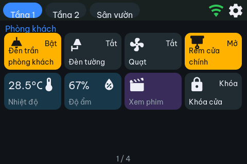
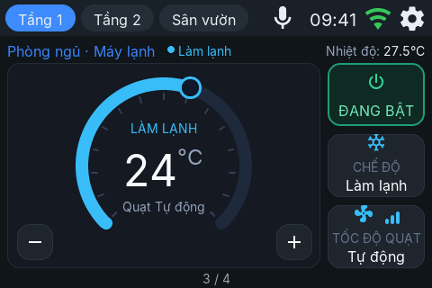
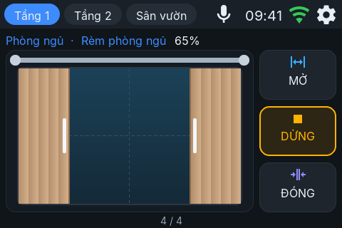

# Screen Hub for Home Assistant

A central control touchscreen for Home Assistant, built on the **ESP32-S3 JC3248W535** 3.5" display.
Pair the screen with Home Assistant, then design its pages from the Home Assistant app: floors, rooms, devices and icons.

  
  
  

*(Images are renders of the UI from a simulator.)*

## Features

- Pages per **floor** (e.g. "Floor 1", "Floor 2"); each floor holds **rooms** with their own titles. When a floor has too many devices it is split into extra pages automatically.
- Swipe left/right between pages, or tap the floor tabs on top to jump straight to a floor.
- Tiles for switches, lights, fans, covers, locks, scenes/scripts/buttons and sensors (temperature, humidity, ...), with a state-aware look.
- A configuration panel in the Home Assistant sidebar (works in the mobile app): add floors/rooms, pick devices, rename them and assign icons from a curated list of ~190 Material Design Icons.
- Local push over WebSocket, no cloud. Each screen has its own key; no long-lived token is stored on the device. The screen can only control entities you placed on it.
- Pairing with a 6-digit code shown on the screen; the screen is discovered through mDNS (or add it by IP).

## Hardware

This integration works with the **ESP32-S3 JC3248W535** touchscreen running the Screen Hub firmware.
The firmware is proprietary and is **not** part of this repository; only the Home Assistant integration is open source.

To get a screen with the firmware installed, contact: **[TikTok @hieu.rcb](https://www.tiktok.com/@hieu.rcb)**

You can still try the configuration panel without hardware, see "Preview mode" below.

## Installation

### HACS

1. Open HACS (or **Settings → Marketplace** on Home Assistant 2026.11+).
2. Add `https://github.com/sdevice-vn/screen-hub` as a custom repository, category **Integration** (skip this step once the repository is in the default list).
3. Download **Screen Hub** and restart Home Assistant.

### Manual

Copy `custom_components/screen_hub` to `<config>/custom_components/` and restart Home Assistant.

## Setup

1. Get a screen with the Screen Hub firmware installed (see [Hardware](#hardware)).
2. On first boot the screen shows a WiFi name + password. Join it with your phone and open `192.168.4.1` to choose your home WiFi.
3. The screen then shows a 6-digit pairing code. In Home Assistant go to **Settings → Devices & services**; the screen appears as discovered. Enter the code. (If it is not discovered, choose **Add integration → Screen Hub** and enter the screen's IP address.)
4. Open **Màn hình HA** (Screen Hub) in the sidebar (admin only) and build your floors, rooms and devices. Press **Save & send to screen**.

### Preview mode

Leaving the IP empty when adding the integration creates a "preview" entry so you can try the panel without hardware.

## Notes

- Only entities from these domains can be placed on the screen: `switch`, `light`, `fan`, `input_boolean`, `automation`, `lock`, `cover`, `scene`, `script`, `button`, `sensor`, `binary_sensor`, `climate`, `weather`.
- The screen font covers Latin and Vietnamese characters. Other characters in device names are shown as empty boxes.
- Icons: [Material Design Icons](https://pictogrammers.com/library/mdi/) (Apache-2.0).

---

## Tiếng Việt

Màn hình điều khiển trung tâm cho Home Assistant dùng màn hình ESP32-S3 JC3248W535. Ghép cặp bằng mã 6 số, rồi tạo **tầng → phòng → thiết bị**, đặt tên và gán icon ngay trong app Home Assistant. Mỗi tầng là một nhóm trang (tự tách trang khi nhiều thiết bị), vuốt trái/phải để chuyển trang hoặc bấm tab tầng để nhảy nhanh.

**Phần cứng:** tích hợp này dùng với màn hình ESP32-S3 JC3248W535 đã nạp firmware Screen Hub. Firmware không công khai và không nằm trong repository này, chỉ phần tích hợp Home Assistant là mã nguồn mở. Liên hệ để có màn hình đã nạp sẵn firmware: **[TikTok @hieu.rcb](https://www.tiktok.com/@hieu.rcb)**

Cài đặt: thêm repository này vào HACS (Integration), tải **Screen Hub**, khởi động lại HA. Cấu hình WiFi cho màn hình theo hướng dẫn trên màn hình, rồi vào **Cài đặt → Thiết bị & dịch vụ** để nhập mã ghép cặp. Sau đó mở mục **Màn hình HA** ở thanh bên để cấu hình giao diện. Để trống ô IP khi thêm tích hợp sẽ tạo mục "xem thử" cho bạn dùng thử giao diện cấu hình khi chưa có màn hình.
